> Parte del [Mapa del CRM](../mapa-crm.md) (índice con todas las secciones). Las capturas están en esta misma carpeta.

#### 3.2.3 Detalle del contacto

La ficha del cliente. Es **la misma** a la derecha de la Bandeja y en el pop-up del Embudo. Se guarda sola al
salir de cada campo: junto al título aparece **"Guardando…"** y luego **"Guardado ✓"** (no hay botón Guardar).
Ningún dato es definitivo: el agente corrige lo que el cliente aclare después.

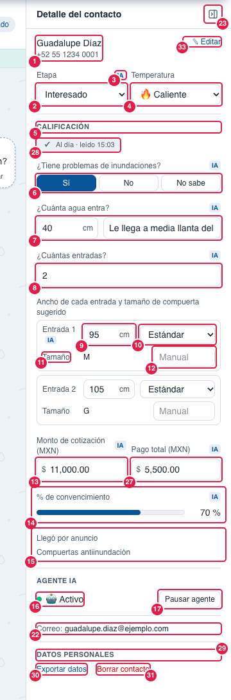
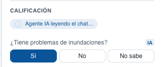
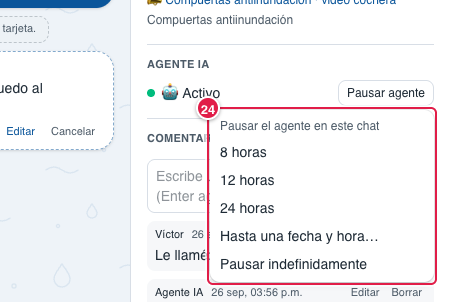
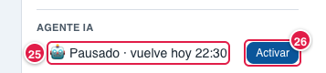
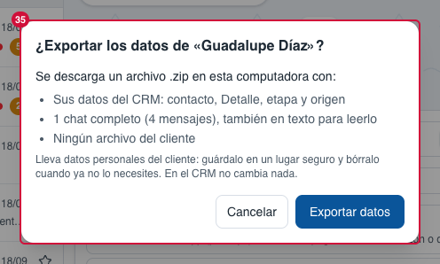
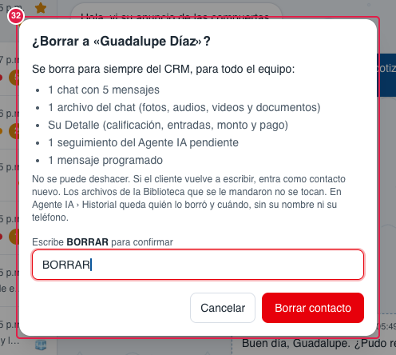
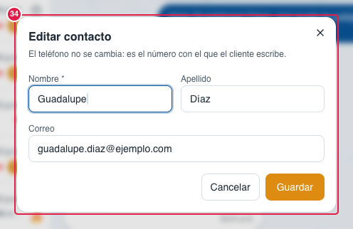
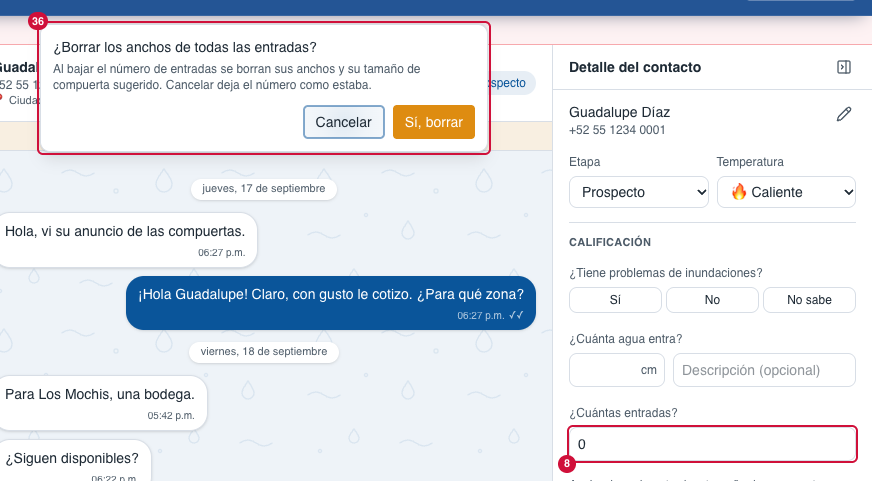
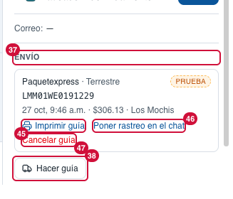
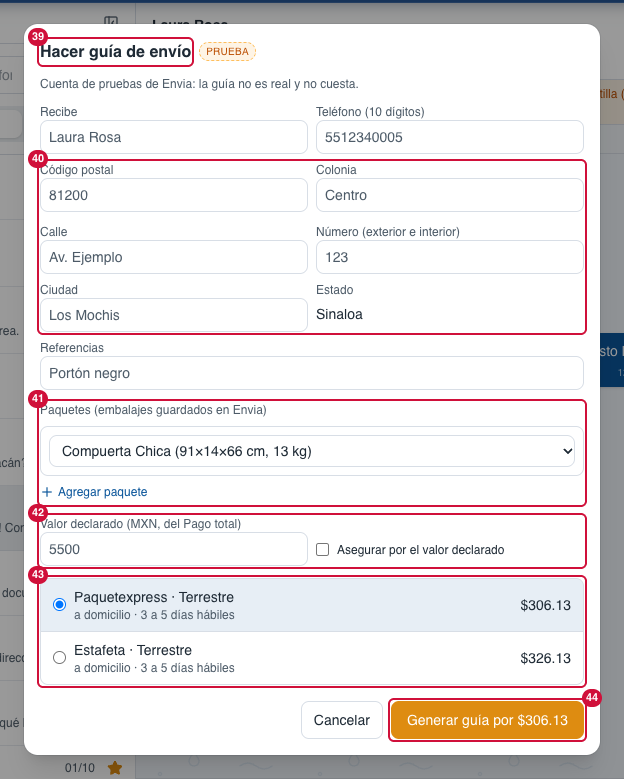
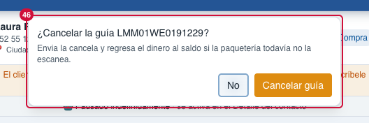

| # | Nombre oficial | Qué hace | Quién lo ve |
|---|---|---|---|
| 1 | **Nombre y teléfono** | Datos del contacto. Un cliente de **Instagram** muestra su **@usuario · Instagram** en lugar del teléfono. El nombre se corrige con el **lápiz ✎** (33); el teléfono no se cambia. | Todos |
| 2 | **Etapa** | Cambiarla aquí la mueve también en el Embudo. La que pone un vendedor manda; el agente solo avanza, también en segundo plano. | Todos |
| 3 | **Marca "IA"** | Ese dato lo escribió el agente al último. Si lo editas, se quita. Cuando lo acaba de llenar dice "IA actualizando" y el campo brilla. | Todos |
| 4 | **Temperatura** | En la **Bandeja**: 🔥 Caliente, 🧊 Frío, ⏳ En espera o Sin asignar (Destacado es la estrella de la lista). En el **pop-up del Embudo** el mismo campo es un menú de dos partes: arriba la temperatura (una) y, abajo de la línea, **⭐ Destacado** (se prende o apaga aparte); el campo muestra las dos, p. ej. «🔥 Caliente ⭐». | Todos |
| 5 | **Calificación** | Sección con las preguntas de la venta. | Todos |
| 6 | **¿Tiene problemas de inundaciones?** | Sí · No · No sabe. | Todos |
| 7 | **¿Cuánta agua entra?** | Centímetros y una descripción opcional. | Todos |
| 8 | **¿Cuántas entradas?** | Número de entradas. Si lo bajas, pregunta primero en el aviso de arriba (36) porque borra anchos. | Todos |
| 9 | **Ancho de la entrada (cm)** | Una fila por entrada. Siempre en **centímetros**, con «cm» a la vista (como el agua, 7). El Agente IA convierte lo que dijo el cliente: 1.75 m → 175 cm, pulgadas × 2.54; un número sin unidad de 10 o más ya son centímetros (230 = 230 cm, nunca metros). | Todos |
| 10 | **Línea** | Mini o Estándar. | Todos |
| 11 | **Tamaño sugerido** | Lo calcula el CRM con [Tallas y medidas](3.6-agente-ia.md#36-agente-ia). | Todos |
| 12 | **Manual** | Tamaño escrito a mano; manda sobre el sugerido. | Todos |
| 13 | **Monto de cotización (MXN)** | Total de lo que el cliente **eligió comprar al final** (si se le cotizaron 2 y eligió 1, es el total de 1). Lo deja al día el Agente IA en segundo plano; puede cambiar aun después de la compra. A la derecha, (27). | Todos |
| 14 | **% de convencimiento** | Barra de qué tan cerca está de comprar. Solo lo decide el agente (no se edita). | Todos |
| 15 | **Llegó por anuncio** | El anuncio que lo trajo (enlace), el resumen que hizo el agente y "También volvió por…". | Todos |
| 16 | **Agente IA (estado)** | 🟢 Activo · 🟠 Pausado · vuelve… · o "Apagado en «canal»". Pausado o apagado solo deja de contestar: el Detalle se sigue llenando en segundo plano (28). | Todos |
| 17 | **Pausar agente** | Abre el menú de pausa (24). | Todos |
| 18–21 | *(Comentarios: se quitaron el 6-oct-2026)* | Ningún vendedor los veía. El Agente IA ya no escribe comentarios; los guardados siguen en la base, pero no se muestran. | — |
| 22 | **Correo** | Dato compacto al final; se cambia con el **lápiz ✎** (33). Las **etiquetas** de GHL ya no se muestran (7-oct-2026, decisión del dueño): siguen guardadas y vuelven con las difusiones (v2). | Todos |
| 23 | **Ocultar panel** | Esconde el Detalle. | Todos |
| 24 | **Pausar el agente en este chat** | 8 horas · 12 horas · 24 horas · Hasta una fecha y hora… · Pausar indefinidamente. | Todos |
| 25 | **🤖 Pausado · vuelve hoy 22:30** | Estado cuando está en pausa (o "Pausado indefinidamente"). | Todos |
| 26 | **Activar** | Regresa al agente a ese chat. Contesta a partir del siguiente mensaje del cliente. Queda en Agente IA › Historial con quién lo hizo (igual que Pausar agente). | Todos |
| 27 | **Pago total (MXN)** | Lo que el cliente **ya pagó** (anticipo + resto, o el pago completo), junto al monto (13): así se ve quién cotizó mucho y no compró. Lo llena el Agente IA en segundo plano con los comprobantes y los pagos confirmados en el chat; se corrige a mano. | Todos |
| 28 | **Agente IA en segundo plano** (bajo Calificación) | Qué está haciendo el Agente IA con el Detalle, en vivo: «⏳ Agente IA leerá el chat en ~3 min» (llegó algo nuevo y espera a que el chat se calme), «Agente IA leyendo el chat…» (lo está leyendo ahora; segunda captura), «Agente IA actualizó 2 datos» (unos segundos, mientras brillan los campos) y «✓ Al día · leído 10:42». Si una lectura falla: «No pudo leer el chat · se reintenta solo». Sale aunque el Agente IA esté apagado o pausado; nunca le escribe al cliente. Si nunca ha leído ese chat, no se muestra. Tampoco en el chat propio del dueño, que el Agente IA no lee (marca fija en la base, sin botón; 26-oct-2026). La misma lectura anota si el cliente dijo que ya compró en Amazon o Mercado Libre (27-oct-2026): eso va a Seguimientos › Amazon y Mercado Libre (3.11 › 22) y cuenta como un dato actualizado, aunque en el Detalle no brille nada. | Todos |
| 29 | **Datos personales** | Sección al final del Detalle (7-oct-2026) para los derechos del cliente sobre sus datos (ARCO): sacarle una copia de todo lo suyo o borrarlo. | Todos |
| 30 | **Exportar datos** | Abre primero la ventana de aviso (35; desde el 26-oct-2026, antes descargaba con el clic). Al confirmar descarga `contacto-<nombre>-<fecha>.zip` con **datos.json** (contacto, origen y anuncio, etapa, temperatura, Detalle con sus entradas, fechas y cada mensaje con fecha en hora de Mazatlán, quién habló —Cliente, Vendedor o Agente IA—, texto, transcripción y nombre de los archivos), **chat.txt** para leer («[2026-10-03 10:12] Cliente: …») y la carpeta **archivos/** solo con lo que **mandó el cliente** (lo que mandó Diluvium va solo por su nombre). Si los archivos del cliente pasan de 200 MB, la ventana (35) lo dice y ofrece **Descargar sin archivos**. | Todos |
| 31 | **Borrar contacto** (rojo) | Abre la ventana de confirmación (32). | Todos |
| 32 | **Ventana «¿Borrar a …?»** | Dice qué se borra para siempre, para todo el equipo: los chats con cuántos mensajes, los archivos del chat, el Detalle, los seguimientos del Agente IA y los mensajes programados pendientes; pide escribir **BORRAR**. Al confirmar, el contacto desaparece de la Bandeja y del Embudo sin recargar (también en las pantallas de los demás) y queda una fila en Agente IA › Historial (tipo «Contactos borrados») con quién y cuándo, sin su nombre y solo con los últimos 4 dígitos del teléfono. Los archivos de la Biblioteca que se le mandaron no se tocan y el gasto de IA del Dashboard se conserva. Si algún archivo no se pudo borrar del almacenamiento, lo dice («quedaron N archivos») con **Reintentar**. No se puede deshacer; si el cliente vuelve a escribir, entra como contacto nuevo. | Todos |
| 33 | **Lápiz ✎ Editar contacto** (a la derecha del nombre) | Botón de lápiz, igual que el de «Editar columnas» del Embudo. Abre la ventana «Editar contacto» (34). | Todos |
| 35 | **Ventana «¿Exportar los datos de …?»** | Aviso antes de descargar (26-oct-2026): «Se descarga un archivo .zip en esta computadora con:» sus datos del CRM (contacto, Detalle, etapa y origen), el chat completo con cuántos mensajes (también en texto para leerlo) y cuántos archivos mandó el cliente con su peso; abajo, que lleva datos personales y hay que guardarlo en un lugar seguro (en el CRM no cambia nada). **Exportar datos** (azul) descarga; **Cancelar**, Esc o un clic afuera la cierran. Si los archivos pasan de 200 MB, el botón dice **Descargar sin archivos**. Mismo marco que la de Borrar (32). | Todos |
| 36 | **Aviso «¿Borrar los anchos …?»** | Al bajar ¿Cuántas entradas? (8) cuando ya hay anchos: «¿Borrar el ancho de la entrada 3?», «¿Borrar los anchos de las entradas 2 a 4?» o «¿Borrar los anchos de todas las entradas?». Sale arriba, centrado, con el estilo del CRM (27-oct-2026; antes era la ventana del navegador), también encima del pop-up del Embudo: «Al bajar el número de entradas se borran sus anchos y su tamaño de compuerta sugerido. Cancelar deja el número como estaba.» **Sí, borrar** (naranja) guarda el número nuevo; **Cancelar**, Esc o un clic afuera regresan el número de antes (Esc no cierra el pop-up del Embudo). | Todos |
| 34 | **Ventana «Editar contacto»** | **Nombre** (obligatorio), **Apellido** y **Correo**; **Guardar** o **Cancelar**. El **teléfono no se cambia**: es el número con el que el cliente escribe (el de un contacto nuevo se pone al crearlo, Embudo › 21). Al guardar, el nombre cambia al instante en la Bandeja, el Embudo y el Detalle, también en las pantallas de los demás; el Agente IA usa el nombre nuevo cuando saluda por nombre. Si el correo no es válido, lo dice y no guarda. | Todos |
| 37 | **Envío** (sección, 27-oct-2026) | Al final del Detalle, antes de «Datos personales»: las guías de envío de Envia.com de este contacto (las 3 más nuevas). Cada una dice paquetería y servicio, número de rastreo, fecha y hora, precio y ciudad. **Prueba** = guía de la cuenta de pruebas de Envia (staging): no es real. **Cancelada** (rastreo tachado) o **No se generó** (con el error de Envia tal cual). Si Envia no está configurado en el servidor, lo dice. Detalle: `docs/envios.md`. | Todos |
| 38 | **Hacer guía** | Abre la ventana «Hacer guía de envío» (39). | Todos |
| 39 | **Ventana «Hacer guía de envío»** | Llega casi llena: **Recibe** y **Teléfono** del contacto (o la dirección de su última guía), una caja por entrada del Detalle con su embalaje y el **valor declarado** del Pago total (27). **Cancelar** o ✕ la cierran; Esc dentro de un campo y un clic afuera no (no se pierde lo escrito). Cambiar un dato después de cotizar borra la cotización. Si el servidor usa la cuenta real de Envia con el candado del saldo cerrado (staging), dice **«Solo cotizar»** y no muestra el botón de generar (44). | Todos |
| 40 | **Dirección** | Al escribir el **Código postal**, Envia llena **Ciudad**, **Estado** y la lista de **Colonias** (se elige o se escribe). Calle, Número (exterior e interior) y Referencias se escriben. El teléfono va a 10 dígitos. | Todos |
| 41 | **Paquetes** | Menú con los **embalajes guardados en Envia** (si se cambia uno allá, aquí sale igual), elegido según el Tamaño del Detalle: XCH → Compuerta Extra Chica, CH → Chica, M → Mediana, G → Grande, XG → Extra Grande. **Medidas a mano (a la medida)** pide largo, ancho, alto y peso. **Agregar paquete** suma otra caja; la ✕ la quita. | Todos |
| 42 | **Valor declarado y seguro** | Valor de la mercancía en MXN (se reparte entre las cajas). **Asegurar por el valor declarado**: seguro de Envia (apagado de fábrica; cuesta aparte). | Todos |
| 43 | **Cotización** (tras **Cotizar**) | Precio y días de **Paquetexpress** y **Estafeta**, de la más barata a la más cara. Cada opción dice si es **a domicilio**, **se deja en sucursal** (llega a domicilio) o **el cliente la recoge en sucursal** (las «Ocurre» de Envia); viene marcada la más barata **a domicilio**. Si una no cotiza, dice por qué y la otra sale igual. | Todos |
| 44 | **Generar guía por $X** (naranja) | Hace la guía con la paquetería marcada: **cobra el saldo de Envia** (en staging, la cuenta de pruebas no cobra). Un doble clic no hace dos guías. Si Envia la rechaza (sin saldo, CP inválido…), el error se ve tal cual y queda en la sección como «No se generó». | Todos |
| 45 | **Imprimir guía** | Abre en otra pestaña el PDF **listo para la impresora de la oficina (HP, carta)**: Paquetexpress = solo la hoja de la guía (antes «página 3 de 3»), Estafeta = su hoja; todo en carta y a tamaño real. Se elige la impresora y **Imprimir**, sin tocar páginas ni escala. | Todos |
| 46 | **Poner rastreo en el chat** | Deja escrito en la caja del chat «Le comparto su guía de … *número*» con la liga de rastreo, **sin mandarlo** (se manda cuando la guía sale a ruta). Si no hay caja a la vista (pop-up del Embudo, o el chat pasó las 24 h y solo deja plantilla), lo copia al portapapeles. | Todos |
| 47 | **Cancelar guía** (rojo) | Pregunta arriba «¿Cancelar la guía …?»; **Cancelar guía** la cancela en Envia, que regresa el dinero al saldo si la paquetería todavía no la escanea (puede tardar días). | Todos |

**Lo cambias tú desde la pantalla:** todos los campos menos el % de convencimiento; nombre, apellido y correo con
el lápiz ✎ (33–34; el teléfono no); pausar y activar al agente; exportar los datos del contacto o borrarlo (29–32);
hacer, imprimir y cancelar guías de envío (37–47).

**Pídeselo a Code:**
- "En Bandeja › Detalle › (27) pago total, separa anticipo y liquidación."
- "En Bandeja › Detalle › (24) menú de pausa, agrega la opción «2 horas»."
- "En Bandeja › Detalle › (30) Exportar datos, agrega también los comentarios internos al zip."
- "En Bandeja › Detalle › (22) vuelve a mostrar las etiquetas" (cuando haya difusiones, v2).
- "En Bandeja › Detalle › (14) % de convencimiento, déjame corregirlo a mano."
- "En Bandeja › Detalle › (34) Editar contacto, agrega un campo «Ciudad»."
- "En Bandeja › Detalle › (43) Cotización, agrega DHL a las paqueterías."
- "En Bandeja › Detalle › (45) Imprimir guía, que Estafeta salga solo con la primera hoja."

**Agente IA aquí:** llena y corrige los campos con lo que dice el cliente (marca "IA"), decide el % de
convencimiento, avanza la etapa y resume el anuncio en (15).
Lo hace **siempre en segundo plano**, aunque esté apagado o pausado en el chat: unos 3 minutos después de que
el chat se calma lee todo en orden y deja al día etapa, datos, monto (13) y pago (27); lo que está haciendo se ve
en vivo en (28). Nunca le escribe al
cliente. Solo avanza la etapa, y la que puso un vendedor a mano la respeta (solo la avanza por algo que pase
en el chat después).

Para Code: `app/(app)/contactos/_components/contact-details.tsx` (+ `contact-entradas`, `contact-comments`, `convencimiento-picker`, `ia-mark`, `agent-contact-switch`), `dashboard/_components/bot-off-menu.tsx`; datos `lib/contacts/qualification.ts`, `lib/actions/contact-qualification.ts` (sin `tags` desde el 7-oct-2026; `contacts.tags` sigue en la base). Editar contacto (33–34): `edit-contact-dialog.tsx`, acción `editContactBasics` (`lib/actions/contacts.ts`) → `lib/contacts/edit-basics.ts` (sin teléfono; aviso `datos`). Datos personales (29–32, ARCO): `contact-arco-section.tsx` + `delete-contact-dialog.tsx` (portal, Esc solo la cierra) + `deleting-contacts.ts` (la Bandeja y el Embudo no la quitan mientras muestra su resultado); acciones `lib/actions/contact-arco.ts` (`getContactArcoSummary`, `deleteContact`, `retryContactFilesDeletion`); borrar `lib/contacts/arco/delete.ts` (llaves propias `keys.ts`, nunca `library/`; bucket después del commit `delete-files.ts`; reintento firmado `pending-files-token.ts`; aviso `contact.deleted` en `lib/contacts/notify-updated.ts`; Historial kind `contacto_borrado`); exportar = ruta GET `app/api/contactos/[contactId]/exportar/route.ts` (`export-data.ts`, `chat-txt.ts`, `export-files.ts` con tope de 200 MB, zip en streaming `zip-stream.ts` con fflate). Detalle en `docs/bandeja.md` › Borrar y exportar un contacto (ARCO).
