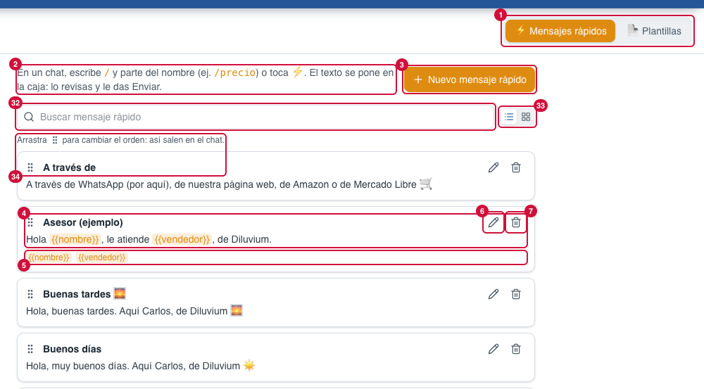
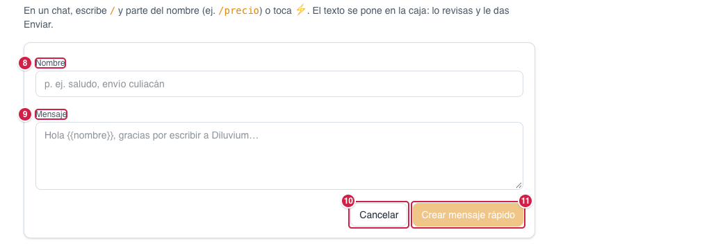
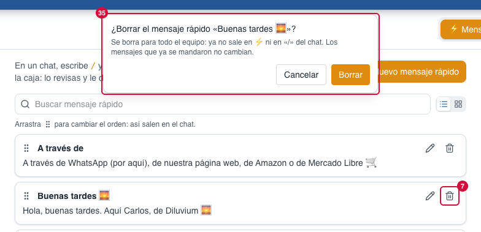
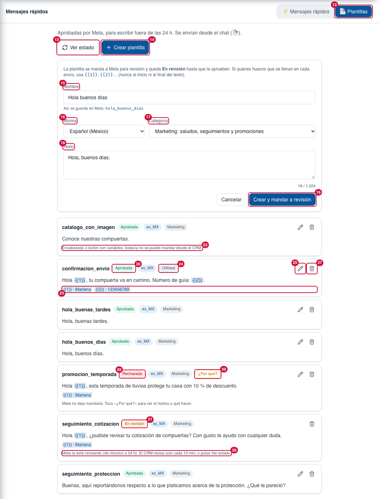
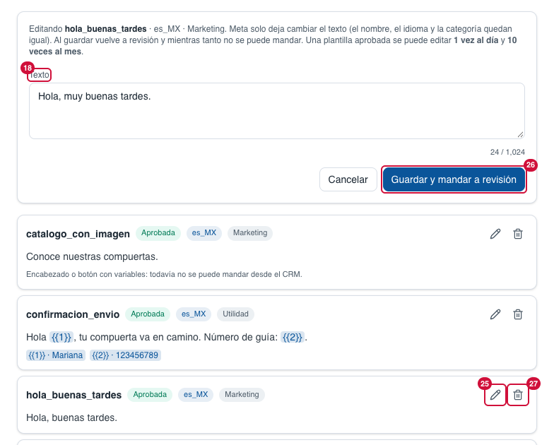
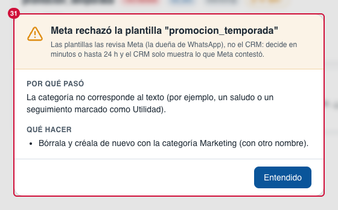

> Parte del [Mapa del CRM](../mapa-crm.md) (índice con todas las secciones). Las capturas están en esta misma carpeta.

### 3.4 Mensajes rápidos

Dos pestañas: **Mensajes rápidos** (respuestas guardadas para dentro de las 24 h; antes se llamaban "Fragmentos") y
**Plantillas** (mensajes aprobados por Meta para fuera de las 24 h). Los 22 mensajes rápidos de Diluvium se cargaron
el 27-sep-2026; se editan aquí como cualquier otro. Desde el 26-oct-2026 tienen buscador (32), vista de lista o
cuadrícula (33) y **orden a mano** (34): el orden que dejes aquí es el de ⚡ en el chat y el de «/». Uno nuevo va al final.

| # | Nombre oficial | Qué hace | Quién lo ve |
|---|---|---|---|
| 1 | **⚡ Mensajes rápidos · 📄 Plantillas** | Pestañas de la sección. | Todos |
| 2 | **Cómo se usan** | "En un chat, escribe / y parte del nombre (ej. /precio) o toca ⚡. El texto se pone en la caja: lo revisas y le das Enviar." | Todos |
| 3 | **Nuevo mensaje rápido** | Abre el formulario (8–11). | Todos |
| 4 | **Mensaje rápido** | Nombre y texto guardado. | Todos |
| 5 | **Variables** | Las variables que usa ({{nombre}}, {{vendedor}}). Solo sale si las usa: los 22 de Diluvium no llevan (en la captura, "Asesor (ejemplo)" es de muestra). | Todos |
| 6 | **Editar** (lápiz) | Cambia el mensaje rápido. | Todos |
| 7 | **Borrar** (bote) | Pregunta primero en el aviso de arriba (35) y lo elimina. | Todos |
| 8 | **Nombre** | Cómo se busca con "/" (p. ej. saludo). | Todos |
| 9 | **Mensaje** (texto) | El mensaje. Con el [corrector ortográfico](1-glosario.md#glosario) (subrayado rojo; clic en la palabra para corregirla). | Todos |
| 10 | **Cancelar** | Cierra sin guardar. | Todos |
| 11 | **Crear mensaje rápido** | Guarda. | Todos |
| 12 | **📄 Plantillas** | Pestaña de plantillas. | Todos |
| 13 | **Ver estado** (antes «Sincronizar») | Trae de Meta las plantillas y su estado actual. No hace falta pulsarlo: el CRM lo revisa solo al abrir la pestaña y cada 10 min mientras alguna esté En revisión. El aviso verde («Estado al día: …») se quita solo a los 5 s. | Todos |
| 14 | **Crear plantilla** | Abre el formulario (15–19). | Todos |
| 15 | **Nombre** | Escríbelo como quieras (p. ej. "Hola buenas tardes"): el CRM lo pasa a minúsculas, sin acentos y con guion bajo, y debajo dice **"Así se guarda en Meta: hola_buenas_tardes"**. | Todos |
| 16 | **Idioma** | Español (México) de fábrica (es_MX); también Español o Inglés. | Todos |
| 17 | **Categoría** | **Marketing** (saludos, seguimientos y promociones; de fábrica) o **Utilidad** (avisos de un pedido ya hecho). Meta cobra distinto por categoría y puede pasar una de Utilidad a Marketing. | Todos |
| 18 | **Texto** | El mensaje, hasta 1,024 caracteres (contador abajo). Huecos {{1}}, {{2}}… seguidos y **nunca al inicio ni al final** (regla de Meta); cada hueco pide un ejemplo. Si algo no va, sale un aviso ⚠ y el botón no se activa. Con el [corrector ortográfico](1-glosario.md#glosario). | Todos |
| 19 | **Crear y mandar a revisión** | La manda a Meta; queda "En revisión" (de minutos a 24 h). Si Meta la rechaza al recibirla, el motivo sale ahí mismo, con lo que explicó Meta (12-oct-2026; antes a veces solo decía «Zernio respondió 400»). Ojo: el nombre de una plantilla **borrada** (aunque no estuviera aprobada) no se puede volver a usar durante unas 4 semanas: Meta dice que ese idioma «is being deleted»; usa otro nombre. | Todos |
| 20 | **Aprobada** | Ya se puede mandar desde el chat. | Todos |
| 21 | **En revisión** | Meta aún no la aprueba; no se puede mandar. | Todos |
| 22 | **"Encabezado o botón con variables: todavía no se puede mandar desde el CRM."** | Aprobada, pero el CRM todavía no puede armarla. | Todos |
| 23 | **Ejemplos de variables** | Qué va en cada {{n}}. | Todos |
| 24 | **Categoría** (etiqueta) | La categoría de esa plantilla (Marketing o Utilidad). | Todos |
| 25 | **Editar** (lápiz de la plantilla) | Cambia **solo el texto** (nombre, idioma y categoría quedan fijos). Solo en aprobadas, rechazadas o pausadas. Vuelve a revisión y mientras tanto no se puede mandar; una aprobada se edita **1 vez al día y 10 al mes** (Meta). | Todos |
| 26 | **Guardar y mandar a revisión** | Guarda la edición (25) y la manda a Meta. | Todos |
| 27 | **Borrar** (bote de la plantilla) | Pide confirmación y la **borra en Meta** y del CRM. Meta no deja volver a usar ese nombre en 30 días. No se deja si hay mensajes programados con ella (primero se cancelan). | Todos |
| 28 | **"Meta la está revisando (de minutos a 24 h)…"** | Aviso de una plantilla En revisión. El CRM revisa solo cada 10 min; o pulsa **Ver estado** (13). | Todos |
| 29 | **Rechazada · Pausada por Meta · Desactivada por Meta** | Otros estados que pone Meta; ninguno se puede mandar. Las borradas ya no se muestran. | Todos |
| 30 | **¿Por qué?** (naranja, junto a la plantilla) | En rechazadas, pausadas o desactivadas: pregunta a Meta el motivo y abre el aviso grande (31). | Todos |
| 32 | **Buscar mensaje rápido** | Filtra por nombre y texto, sin importar acentos ni mayúsculas («envio» encuentra «Datos de envío»). Mientras hay búsqueda no se puede cambiar el orden: dice «Para cambiar el orden, borra la búsqueda.». | Todos |
| 33 | **Lista / Cuadrícula** | Íconos a la derecha del buscador, los mismos de Elegir plantilla del chat: lista (un mensaje rápido por renglón, texto completo) o tarjetas (3 columnas si cabe, hasta 6 renglones de texto). Se recuerda en esta computadora. | Todos |
| 34 | **⋮⋮ Cambiar el orden** (manija a la izquierda del nombre) | Arrastra la manija y suelta el mensaje rápido donde quieras: una raya azul marca dónde va a quedar (arriba o abajo en la lista; a la izquierda o a la derecha en la cuadrícula). Se guarda al soltar, para todo el equipo; es el orden de ⚡ en el chat (Caja para escribir › 27) y de «/» con la búsqueda vacía. En el celular, deja el dedo un momento en la manija antes de moverla. Arriba de la lista: «Arrastra ⋮⋮ para cambiar el orden: así salen en el chat.». Queda en Agente IA › Historial («Cambió el orden de los mensajes rápidos», con el antes y el después en Ver cambios). | Todos |
| 35 | **Aviso «¿Borrar el mensaje rápido «…»?»** | Sale arriba, centrado, con el estilo del CRM (27-oct-2026; antes era la ventana del navegador): «Se borra para todo el equipo: ya no sale en ⚡ ni en «/» del chat. Los mensajes que ya se mandaron no cambian.» **Borrar** (naranja) lo elimina; **Cancelar**, Esc o un clic afuera lo cierran. Al borrarlo, arriba sale «✓ Mensaje rápido «…» borrado.» unos segundos. Queda en Agente IA › Historial. | Todos |
| 31 | **Aviso de Meta** (pop-up grande) | Sale solo cuando Meta no acepta algo de una plantilla (al crear, editar, borrar, al ver el estado (13, o el CRM solo) si alguna quedó rechazada o pausada, o con 30): título, que lo decide Meta y no el CRM, **Por qué pasó** (el motivo de Meta en palabras simples), **Qué hacer** y **Entendido**. | Todos |

**Lo cambias tú desde la pantalla:** crear, editar, borrar y acomodar (34) mensajes rápidos; crear, editar (van a revisión de Meta) y borrar plantillas, y ver su estado (Ver estado).
Cada uno de esos cambios queda en **Agente IA › Historial** (72) con quién lo hizo y su texto (**Ver cambios**, 77).

**Pídeselo a Code:**
- "En Mensajes rápidos › (34), agrega flechas ↑ ↓ para subir o bajar un mensaje rápido sin arrastrarlo."
- "En Mensajes rápidos › (22), que el CRM pueda mandar plantillas con imagen en el encabezado."

**Agente IA aquí:** no usa mensajes rápidos ni plantillas; son herramientas del vendedor.

Para Code: ruta `/mensajes-rapidos` (`/snippets` redirige); `app/(app)/snippets/_components/` (`fragmentos-tab`, `fragmentos-lista` —arrastrar con dnd-kit—, `plantillas-tab`); orden en
`snippets.position` (migración 0073; `reorderSnippets` en `lib/actions/snippets.ts`, `lib/snippets/orden.ts`); `lib/snippets/`, `lib/templates/`, `lib/messaging/template-sync.ts`; plantillas: `lib/actions/templates.ts` (devuelven `{ ok, message }`: en producción Next.js esconde el mensaje de un error lanzado), `lib/messaging/templates.ts` (`updateTemplateForOrg`, `deleteTemplateForOrg`), reglas puras en `lib/messaging/template-format.ts` (`templateNameFromLabel`, `templateBodyProblem`), Zernio `PATCH`/`DELETE /v1/whatsapp/templates/{name}`. En código y base
siguen llamándose `snippets`. Carga de los 22: `npm run mensajes-rapidos:cargar` (simula; `--confirmar` escribe) con la lista de
`lib/snippets/mensajes-rapidos-diluvium.ts`.
