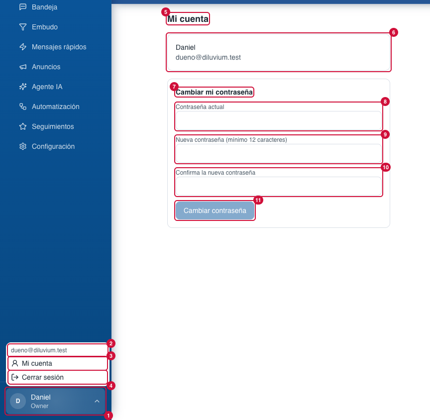
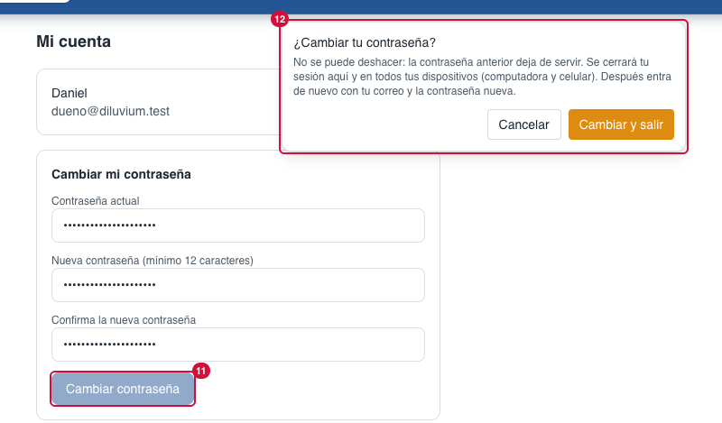
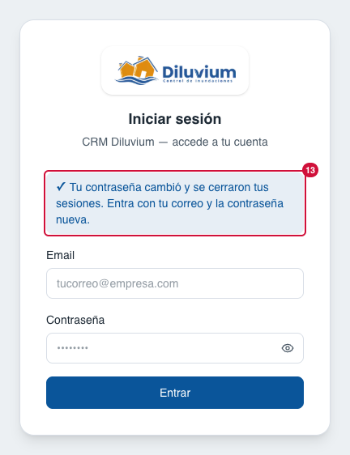

> Parte del [Mapa del CRM](../mapa-crm.md) (índice con todas las secciones). Las capturas están en esta misma carpeta.

### 3.9 Menú del usuario y Mi cuenta

Abajo del menú lateral, para todos.

| # | Nombre oficial | Qué hace | Quién lo ve |
|---|---|---|---|
| 1 | **Botón del usuario** | Tu nombre y rol; clic abre el menú. | Todos |
| 2 | **Correo** | Con qué cuenta entraste. | Todos |
| 3 | **Mi cuenta** | Abre la página Mi cuenta. | Todos |
| 4 | **Cerrar sesión** | Abre el mismo globo de confirmación de la barra (Menú › 10), pegado al botón del usuario (1); solo sale con su botón naranja. | Todos |
| 5 | **Mi cuenta** (página) | Título de la página. | Todos |
| 6 | **Tu nombre y correo** | Datos de tu cuenta. | Todos |
| 7 | **Cambiar mi contraseña** | Formulario para cambiar tu contraseña. | Todos |
| 8 | **Contraseña actual** | La que usas hoy. | Todos |
| 9 | **Nueva contraseña (mínimo 12 caracteres)** | La nueva. | Todos |
| 10 | **Confirma la nueva contraseña** | Repetirla. | Todos |
| 11 | **Cambiar contraseña** | No la cambia todavía: abre el aviso de arriba (12). | Todos |
| 12 | **Aviso «¿Cambiar tu contraseña?»** | Sale arriba, centrado (27-oct-2026): «No se puede deshacer: la contraseña anterior deja de servir. Se cerrará tu sesión aquí y en todos tus dispositivos (computadora y celular). Después entra de nuevo con tu correo y la contraseña nueva.» **Cambiar y salir** (naranja) la cambia, cierra **todas** tus sesiones y te lleva a Iniciar sesión (13); **Cancelar**, Esc o un clic afuera lo cierran. Si la actual está mal, no cambia nada, sigues dentro y abajo del formulario dice «La contraseña actual no es correcta.» | Todos |
| 13 | **Aviso de Iniciar sesión** | Después del cambio, arriba del formulario de entrada: «Tu contraseña cambió y se cerraron tus sesiones. Entra con tu correo y la contraseña nueva.» En tus otros dispositivos (celular, otra computadora) también te pide entrar otra vez. | Todos |

**Lo cambias tú desde la pantalla:** tu contraseña.

**Pídeselo a Code:**
- "En Mi cuenta › (6), déjame cambiar mi nombre."
- "En Menú del usuario › (1), agrega el botón de tema claro/oscuro dentro del menú."

**Agente IA aquí:** nada.

Para Code: ruta `/mi-cuenta`; `app/(app)/_components/user-menu.tsx`, `app/(app)/mi-cuenta/_components/my-account-form.tsx`, `changeMyPassword` en `lib/actions/team.ts` (cierra todas las sesiones y redirige a `/sign-in?aviso=contrasena`); el aviso de entrada en `app/(auth)/sign-in/_components/sign-in-notice.tsx` y `lib/auth/sign-in-notice.ts`.
